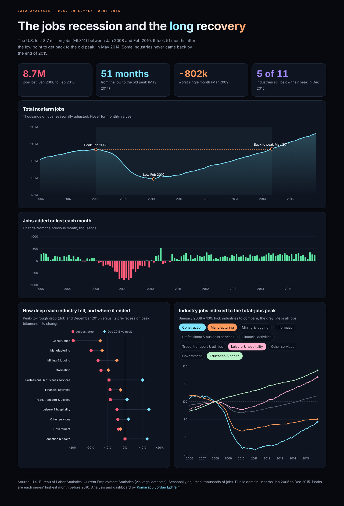

# US Jobs: Recession and Recovery (2006–2015)

A data analysis and interactive dashboard of U.S. employment through the 2008 recession and the recovery that followed, by industry. Pure Python for the analysis, hand-drawn SVG charts for the dashboard, no libraries.

**[Open the dashboard](dashboard/index.html)** (download and open in a browser, or serve with GitHub Pages).

<p align="center"></p>

## What the data shows

All numbers below are computed by `analysis.py` from the data file.

- Total nonfarm jobs peaked in **January 2008** and fell to a low in **February 2010**: about **8.7 million jobs lost (-6.3%)**.
- The worst single month was **March 2009 (-802k)**.
- It took **51 months** after the low to get back to the old peak, in **May 2014**.
- **Construction (-29.8%)** and **manufacturing (-19.5%)** fell furthest and were still 14.2% and 13.1% below their peaks in December 2015.
- **Education & health never declined** and ended 12.7% above its pre-recession peak; leisure & hospitality ended 13.7% above.
- 5 of 11 industries had not regained their peak by December 2015.

## Data

`data/us-employment.csv`: U.S. Bureau of Labor Statistics, Current Employment Statistics, January 2006 to December 2015, monthly, seasonally adjusted, thousands of jobs, 11 supersectors plus totals. Public domain; taken from the [vega-datasets](https://github.com/vega/vega-datasets) package, which reformatted the BLS download.

## Method

- A series' **peak** is its highest month before 2010; its **low** is the lowest month after that peak; **recovered** is the first later month at or above the peak.
- Industry lines are indexed to January 2008 (the total-jobs peak) = 100 so industries of very different size can be compared.
- Limits: seasonally adjusted totals only, no wages or hours, and sector peaks are measured on each sector's own timing.

## Run it

```bash
python analysis.py                      # prints the findings, writes dashboard/index.html and data.json
python -m unittest discover -s tests    # 6 tests
```

## License

MIT for the code. Data: U.S. government work, public domain. By [Komarapu Jordan Ephraim](https://komarapujordanephraim-creator.github.io).
